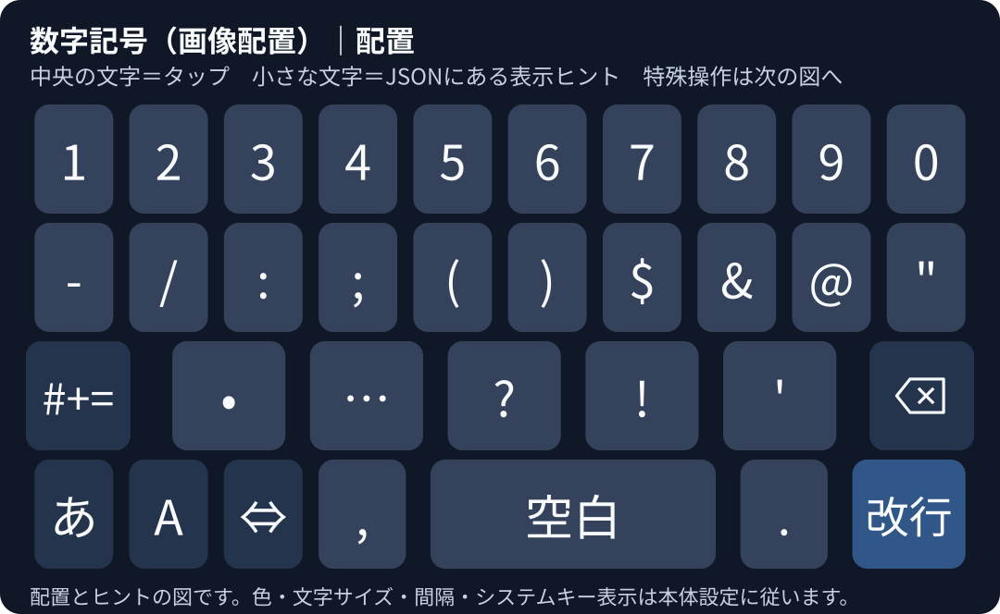
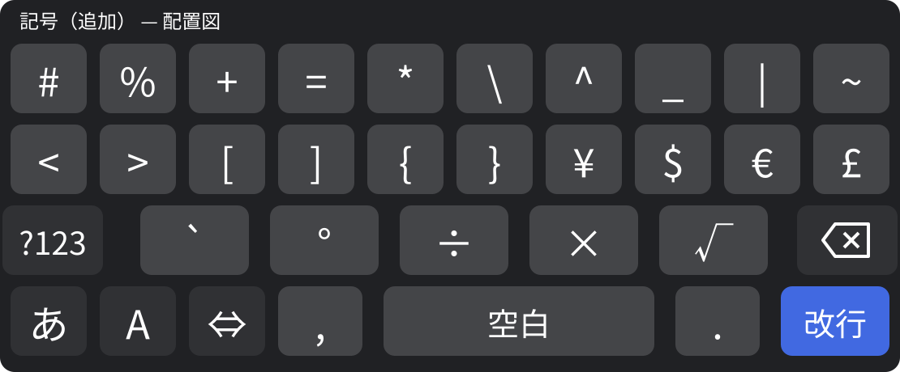

# azooKey GODAN・QWERTY・数字記号カスタムタブ

azooKey公式のGODANを元にしたヒント付き配列、幅比較版、Androidの参考画像に寄せたGODAN・英字QWERTY・数字記号セットを配布しています。

## 画像に寄せたGODAN・英字QWERTY・数字記号セット

**azooKey 3.1以降向け**です。英字QWERTYのShiftに、3.1で追加されたカスタムタブ用のShiftキーを使用しています。[公式リリース](https://github.com/azooKey/azooKey/releases/tag/v3.1)

次のURLを「拡張」→「カスタムタブの管理」→「URLから読み込む」に貼り付けてください。GODAN・QWERTY・数字記号・追加記号の4つのプレビューが表示されるので、**4つすべての「保存」を押してください**。「タブバーに追加」はオンのままにします。

以前の2タブセットを読み込み済みの場合も、このURLから再度読み込みます。既存のGODAN・QWERTYは同じ識別子で更新するため、上書き確認が出たら上書きしてください。数字記号・追加記号も保存すると、新しい切替先が使えるようになります。

```text
https://raw.githubusercontent.com/H4M4CHi-ttr/azookey-godan-flick-hints/main/gboard-like-pair.json
```

[セットの読み込み用JSON](https://raw.githubusercontent.com/H4M4CHi-ttr/azookey-godan-flick-hints/main/gboard-like-pair.json)

保存後はタブバーで「GODAN（画像配置）」を選びます。左下の大きな「ABC」キーを押すと「QWERTY（英字）」へ、QWERTY下段の「五段」キーを押すとGODANへ戻ります。「123」の操作で「数字記号（画像配置）」へ移動し、そこから「あ」でGODAN、「A」でQWERTYへ戻れます。「#+=」は「記号（追加）」、追加記号の「?123」は数字記号へ切り替えます。切替時は入力中の文字を確定します。

| タブ | 配置と操作 |
| --- | --- |
| GODAN（画像配置） | 均等な5列・5段。左列は小゛゜・左カーソル・🙂記・2段分のABC、右列は削除・右カーソル・空白・2段分の改行。中央の文字配列は公式GODANと同じです。 |
| QWERTY（英字） | 英字キーを等幅にし、10・9・7個の各段を中央に揃えた逆ピラミッド配置です。Shift・削除と、下段の123・五段・カンマ・空白・ピリオド・左右カーソル・改行を備えています。アルファベットをそのまま入力する英字タブです。 |
| 数字記号（画像配置） | 参考画像と同じ4段構成。上段に1〜0、2段目にハイフン・スラッシュ・コロン・セミコロン・丸括弧・ドル・アンパサンド・アットマーク・二重引用符を配置しています。下段には「あ」「A」、カーソル操作、カンマ、大きな空白、ピリオド、改行があります。 |
| 記号（追加） | ハッシュ・パーセント・演算子・角括弧・波括弧・通貨記号などを配置した2枚目。下段の配置は数字記号と共通です。 |

- **カーソル移動**：両タブの左右キーはタップで1文字、長押しで連続移動します。空白を長押しすると上部にカーソルバーが出ます。指を離してから、そのバーを左右にスワイプしてください。
- **GODAN中央下の⇔**：タップまたは長押しでカーソルバーの表示を切り替えます。表示中にもう一度操作すると閉じます。左右フリックで1文字ずつ移動し、フリックした方向で押し続けると連続移動できます。
- **⇔の上フリック**：クリップボードの内容をペーストします。本家と同じクリップボードのアイコンが候補に表示されます。ペーストにはazooKeyの「フルアクセス」が必要です。
- **QWERTY空白の上スワイプ**：同じペースト操作を使えます。通常の空白入力と、長押しのカーソルバー表示はそのまま使えます。フルアクセスが必要です。
- **数字・記号**：GODANの下フリックで1〜9、Nの下フリックで0を入力できます。QWERTYは各文字キーの上スワイプまたは長押しで、小さく表示した数字・記号を入力します。上スワイプは長押しが成立する前に行います。
- **ハイフン・小数点・スラッシュ**：GODANのE下フリックで半角 `-`、O下フリックで半角 `.` を入力できます。QWERTYの `h` 上スワイプ・長押しで `-`、ピリオド上スワイプ・長押しで `/` を入力できます。
- **英字の大文字**：QWERTYのShiftで次の入力を大文字にできます。Shiftの長押し・ダブルタップはCaps Lockに対応します。
- **追加候補**：GODANの母音キーは画像に合わせて補助ヒントを減らしていますが、公式のフリック入力は保持しています。たとえばAの左「あっ」・上「あん」・右「ゃ」は引き続き使えます。
- **数字記号への切替**：GODANの「🙂記」右フリック・「ABC」上フリック、QWERTYの「123」は、このセットの数字記号タブへ移動します。
- **標準タブ**：GODANの「🙂記」タップは標準の絵文字タブです。絵文字・クリップボード履歴からこのセットへ戻る場合はタブバーから選べます。

### Gboard風の数字・記号配置



数字記号の3段目は「#+=・•・…・?・!・'・削除」です。4段目は「あ・A・⇔・,・空白・.・改行」です。記号と数字は変換せず、そのまま入力します。



追加記号は、参考画像に写っていない2枚目の配列として、よく使う記号を優先しています。

- **⇔**：タップ・長押しでカーソルバーを表示／非表示にします。左右フリックは1文字移動、方向を保持すると連続移動します。上フリックは貼り付け、下フリックは履歴です。
- **空白**：タップで半角空白、長押しでカーソルバー、上スワイプで貼り付け、下スワイプで履歴を使えます。
- **削除**：タップ・長押しは左の文字を削除します。右スワイプは右の1文字、左スワイプは句読点・改行などまで削除します。
- **改行キー**：azooKey標準のキーを使用し、入力欄に応じた「実行」「検索」「改行」などの表示に従います。

参考画像の歯車の位置は「⇔」に置き換えています。配置図の色・文字サイズ・キー間隔は参考表示です。実際の外観はazooKeyの着せ替え・文字サイズ・キーボード高さに従います。GboardのGoogleボタンや音声入力ボタンは含めていません。

### 追加したフリック操作

| キー | 方向 | 操作 |
| --- | --- | --- |
| GODANの🙂記 | 上 | クリップボード履歴を開く |
| 両タブの左カーソル | 下 | 空白・句読点・改行を基準に前へ移動 |
| 両タブの右カーソル | 下 | 空白・句読点・改行を基準に次へ移動 |
| GODANのABC・QWERTYの五段 | 下 | タブバーの表示を切り替える |
| QWERTYの123 | 上 | キーボードを閉じる |
| GODAN・QWERTYの削除 | 右 | カーソル右の1文字を削除 |
| GODANのW | 下 | `「」` を挿入し、カーソルを内側へ移動 |
| QWERTYのk | 下 | `()` を挿入し、カーソルを内側へ移動 |
| QWERTYの全英字キー | 上 | 表示済みの副文字を入力（長押しと同じ数字・記号） |
| GODANのE・O | 下 | それぞれ半角 `-`・`.` を入力 |
| QWERTYのピリオド | 上 | `/` を入力 |
| QWERTYの空白 | 下 | クリップボード履歴を開く |

括弧ペアの操作は、入力中の文字を確定して空の括弧を挿入します。選択中の文字がある場合は、その文字を括弧で囲むのではなく、空の括弧に置き換えます。[直接入力とカーソル移動の定義](https://github.com/azooKey/azooKey/blob/754a9ad17cf300596d761845466b9faa652835f5/AzooKeyCore/Sources/KeyboardViews/ActionUtils.swift#L17-L36)

「句読点まで」の削除は、確定済みの文章では前の句読点・改行まで、未確定文字がある場合はその入力中のカーソルより前を削除します。区切りに接している場合は1文字だけ削除します。以前のGODANの「全削除」は同じ処理で、動作が分かる名前へ変更しました。文書全体の削除や、単語の意味による区切り判定ではありません。[公式の削除処理](https://github.com/azooKey/azooKey/blob/754a9ad17cf300596d761845466b9faa652835f5/Keyboard/Display/InputManager.swift#L556-L637)

履歴の保存には履歴保存設定の有効化と「フルアクセス」が必要です。このフリックは履歴画面を開きます。[公式の履歴保存処理](https://github.com/azooKey/azooKey/blob/b50db4aec1069a8d2341f70415da3bdc61f1fce6/AzooKeyCore/Sources/KeyboardViews/ClipboardHistoryManager.swift)

前後移動の区切りは半角・全角空白、日本語・英語の句読点、改行です。区切りに接している場合は1文字だけ進む・戻るので、もう一度フリックすると次の区切りまで移動できます。未確定の文字がある場合は、ライブ変換では確定し、それ以外では入力中の文字列の端へ移動します。単語の意味を判定する移動や、画面上の上下移動には対応していません。[公式のカーソル移動処理](https://github.com/azooKey/azooKey/blob/b50db4aec1069a8d2341f70415da3bdc61f1fce6/Keyboard/Display/InputManager.swift)

GODAN左上は「小゛゜」です。JSONから呼び出せるUndoがないため、この位置に濁点・半濁点・小書きのキーを置いています。中央最下段はカーソル専用キーです。OSのキーボード切替にはiPhone画面下の地球儀を使います。このセット内にはOS切替専用キーを配置していないため、キーボード自身に地球儀キーが必要な端末では、別の配列から切り替えてください。QWERTYのカンマ・ピリオドは半角の `,` と `.` です。

キーの色やフォントはazooKeyの着せ替え・文字サイズ設定に従います。「🙂記」はUnicode文字で表示しています。SVGの埋込みはCustardのラベル形式にありません。QWERTYの小さな副文字はキー上部の中央に表示されます。空白や⇔を押したままその場で左右に滑らせるトラックパッド操作は、このセットには含まれていません。

### 文字が詰まって見えるとき

1. azooKeyアプリの「設定」を開きます。
2. 「表示」欄の「キーの表示サイズ」をオンにします。
3. スライダーを **左端から約4割の位置** に調整します。内部のサイズ値で20前後の目安です。見本の文字を見ながら微調整してください。

設定をオンにした直後は18、調整範囲は15〜28です。数値を直接入力する欄はありません。自動設定では1文字ラベルの上限が25なので、20は約0.8倍の目安です。実際の自動サイズはキー幅でも変わります。この設定はGODAN・QWERTYなど全体に適用され、ヒント文字も連動して小さくなります。[公開版の設定画面](https://github.com/azooKey/azooKey/blob/v3.1/MainApp/Features/Settings/SettingsHomeView.swift)

### 数値欄への自動テンキー切替

azooKey本体には、アプリから `.numberPad` が指定されるとテンキー、`.decimalPad` なら小数点付きテンキーを一時表示する機能があります。このJSONに条件分岐を追加する必要はありません。[azooKeyの入力欄別処理](https://github.com/azooKey/azooKey/blob/v3.1.1/AzooKeyCore/Sources/KeyboardViews/VariableStates.swift#L277-L308)

Webの `type="number"` だけでは、必ずテンキーになるとは限りません。WebKitは `inputmode="numeric"` を数値テンキー、`inputmode="decimal"` を小数テンキーとして扱います。[WebKitの対応付け](https://github.com/WebKit/WebKit/blob/bda67bee92094a1ee81d8a9213930fed831b7196/Source/WebKit/UIProcess/ios/WKContentViewInteraction.mm#L7444-L7500)

```html
<input type="number" inputmode="numeric">
```

実際の対象ページの属性や、そこでの自動切替は実機で未確認です。手動で「123」を押した画面だけでは、自動切替の確認にはなりません。

個別に読み込む場合は、[GODAN単体](https://raw.githubusercontent.com/H4M4CHi-ttr/azookey-godan-flick-hints/main/godan-gboard-like.json)、[QWERTY単体](https://raw.githubusercontent.com/H4M4CHi-ttr/azookey-godan-flick-hints/main/qwerty-gboard-like.json)、[数字記号単体](https://raw.githubusercontent.com/H4M4CHi-ttr/azookey-godan-flick-hints/main/numbers-gboard-like.json)、[追加記号単体](https://raw.githubusercontent.com/H4M4CHi-ttr/azookey-godan-flick-hints/main/symbols-gboard-like.json)の4つを保存してください。

## ヒント付き標準版

フリック方向の文字を小さく常時表示する配列です。たとえば「K」の上に「Q」、右に「G」が表示されます。

### 読み込み方

1. 次のURLをコピーします。
2. azooKeyアプリの「拡張」→「カスタムタブの管理」→「URLから読み込む」で貼り付け、「保存」を押します。
3. キーボードのタブバーで、読み込んだタブを選びます。標準版は「GODAN（ヒント付き）」です。

```text
https://raw.githubusercontent.com/H4M4CHi-ttr/azookey-godan-flick-hints/main/godan-flick-hints.json
```

[読み込み用JSON](https://raw.githubusercontent.com/H4M4CHi-ttr/azookey-godan-flick-hints/main/godan-flick-hints.json)

## 幅配分を調整した比較版

両手の親指で比較するため、文字キーを広げ、左右の文字列を少し外側へ寄せた試作です。キー間の隙間も狭くなります。読み込むと「GODAN（幅比較）」という別タブになります。

```text
https://raw.githubusercontent.com/H4M4CHi-ttr/azookey-godan-flick-hints/main/godan-android-width.json
```

[比較版の読み込み用JSON](https://raw.githubusercontent.com/H4M4CHi-ttr/azookey-godan-flick-hints/main/godan-android-width.json)

| 項目 | 標準版 | 比較版 |
| --- | --- | --- |
| タブ名 | GODAN（ヒント付き） | GODAN（幅比較） |
| 横の幅配分（左補助・文字3列・右補助） | 1:1:1:1:1 | 4:5:5:5:4 |
| 文字の並び・縦の段数 | GODAN・5段 | GODAN・5段 |
| 入力動作・フリック・ヒント | 公式GODANの入力動作と方向ヒント | 標準版と同じ |

比較版の幅配分は、[旧公開Mozc AndroidのGODAN](https://chromium.googlesource.com/external/mozc/+/19d8234eb93adc4f2d1cba8e1d41adfcb33e695d/src/android/resources_oss/res/xml/kbd_godan_kana.xml#56)の、左右補助キー17.3％・文字キー21.8％を参考にしています。JSONでは横23セルを4・5・5・5・4セルに分け、約17.39％・21.74％の配分を指定しています。表示幅・中心位置・キー間の隙間にはazooKeyの描画計算も反映されます。

調整対象は横の配分です。段ずらし、操作キーの移動、ヒントの文字サイズ変更は含めていません。現行Gboardの寸法とは照合していません。

普段の持ち方・同じ文字サイズとキーボード高さで、2つのタブを交互に試してください。狙ったキーから隣のキーへずれる回数や、狭くなった隙間・ヒントの見やすさを比較できます。

## 標準版の変更内容

- 英字キー14個と空白キーに、元のフリック候補と同じ文字を添えています。
- キー配置、通常入力、フリック入力、長押し、文字の置換処理は公式GODANと同じです。
- 識別子を `godan_flick_hints`、表示名を「GODAN（ヒント付き）」に変え、元のGODANとは別のタブとして読み込めます。
- 補助文字のサイズはazooKeyの既存の `main_and_directions` 表示に従います。色は中央の文字と同じです。

システムキーと削除キーのアイコンは元のままです。

## 確認状況

ヒント付き標準版と幅比較版は、JSONの構文、方向ラベルの形式、元データとの比較を確認しています。標準版はヒントとタブ名・識別子、幅比較版はそれらに加えて横の格子数・キーのx位置・幅を変更しています。それ以外のデータは公式GODANと一致しています。

画像配列セットは、4タブ間の切替先、配置の範囲と重複、全英字と長押し・上スワイプの数字・記号、カーソルキー・空白長押し・括弧ペア・右削除の定義を確認しています。GODANの元の文字入力・置換処理・既存フリック候補を保持し、数字と補助フリックを追加しています。セットJSONは個別JSONと同じ内容です。

リポジトリの `python scripts/check_layouts.py` で、JSONの構造・キーの重複や範囲・切替先・セットと個別JSONの一致を確認できます。

iPhone / iPadでの読み込み、表示や操作は未確認です。

## 出典とライセンス

元データは[azooKey公式GODAN](https://azookey.com/static/custard/godan.json)です。[公式カスタムタブ紹介](https://azookey.com/CustomTabs)も参照してください。

比較元には、[azooKey-siteの固定版](https://github.com/azooKey/azooKey-site/blob/01a4779becc21cabbcb6532c2c8908616dad5817/public/static/custard/godan.json)を使用しました。取得した公式配布ファイルと固定版のSHA-256は同一です。

```text
535bf23c327235b02bab74f6f64881a41db820cf635da38a96758a409a4745a0
```

元データの著作権表示は `Copyright (c) 2024 ensan (Keita Miwa)` です。[元リポジトリのライセンス説明](https://github.com/azooKey/azooKey-site/blob/01a4779becc21cabbcb6532c2c8908616dad5817/README.md)に従い、MITライセンスの全文を [LICENSE](LICENSE) に同梱しています。このリポジトリもMITライセンスで公開しています。

